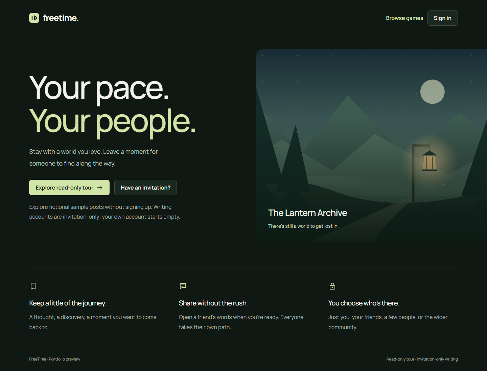

# Zuhair Wahaishi

<!-- freetime-portfolio -->
## FreeTime

I am building FreeTime: a game-led place to keep a reaction, choose its audience, deliberately open moments and continue a conversation.

The current application uses React, TypeScript, a Node server and persistent relational records, with server-enforced audience checks, all-of spoiler requirements, private drafts and reviewed-image workflows. Local multi-account journeys and restart recovery are tested.

[Development repository](https://github.com/zozog12/freetime) (private; collaborator access required). A hosted portfolio preview is in preparation. This is not a claim of public-release readiness or complete game-story coverage.
<!-- freetime-portfolio -->

<!-- freetime-portfolio -->
## FreeTime

I am building FreeTime, a place to keep game reactions and return to conversations at your own pace.

[Explore the live read-only demo](https://freetime-portfolio-demo.leapingflame1.chatgpt.site) ? [Development repository (private)](https://github.com/zozog12/freetime)

The current preview includes live IGDB game search and covers, persisted collections and private drafts, author-confirmed moments, deliberate spoiler opening, replies, and an assigned screenshot-review workflow. The public tour uses labelled fictional activity; writing requires an invitation.

Built with React and TypeScript. Node24/SQLite locally; a Cloudflare Worker with D1 and private R2 image storage for the hosted preview. Multi-account privacy and persistence were exercised against the deployed application and across redeployment. Independent agent browser review covered desktop and phone-sized layouts.

Precise story matching is demonstrated with a fictional game. Real-game maps still require human approval; real-game moments remain explicitly unconfirmed. This is a portfolio preview, not human pilot evidence or a general public release.
<!-- /freetime-portfolio -->
